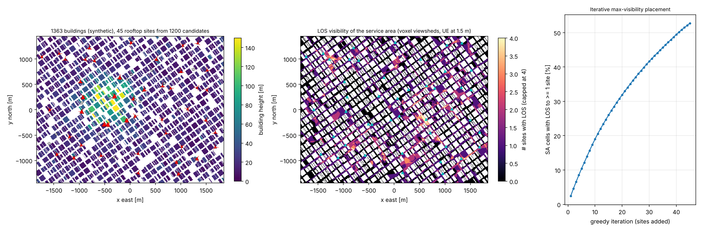
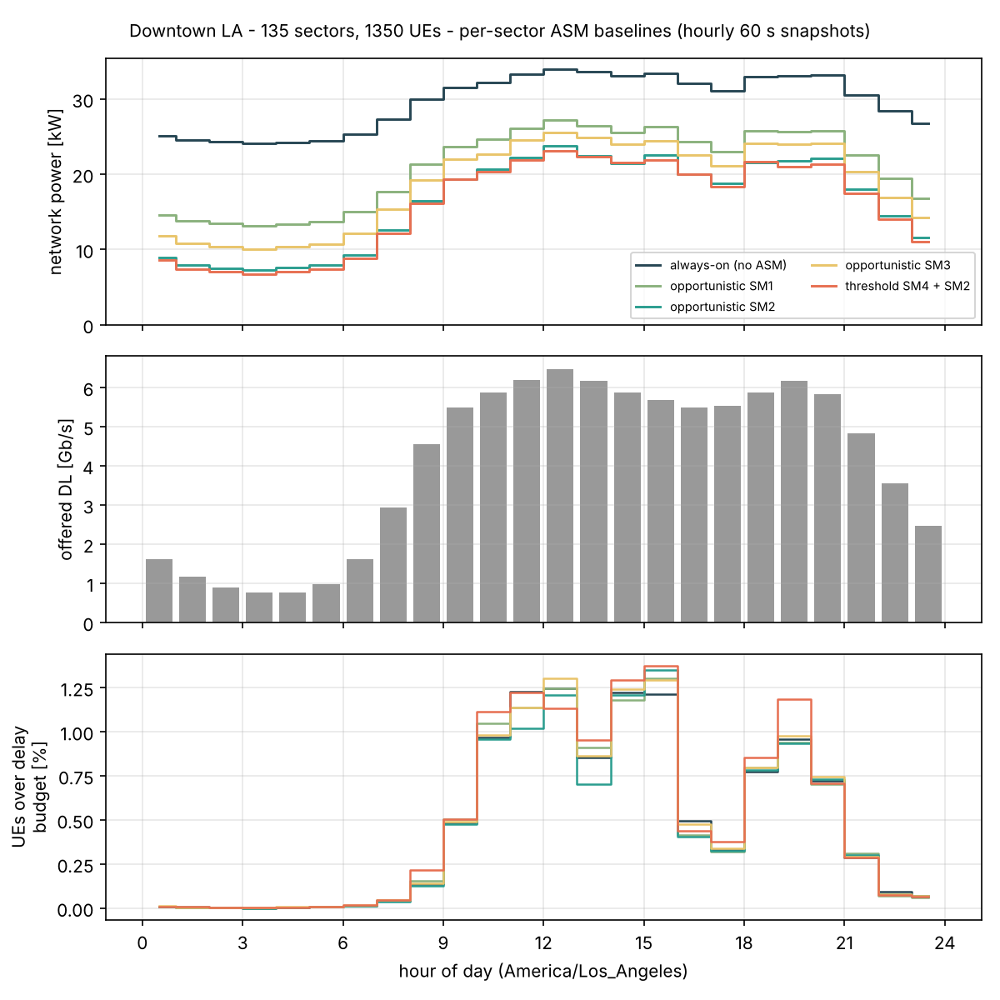
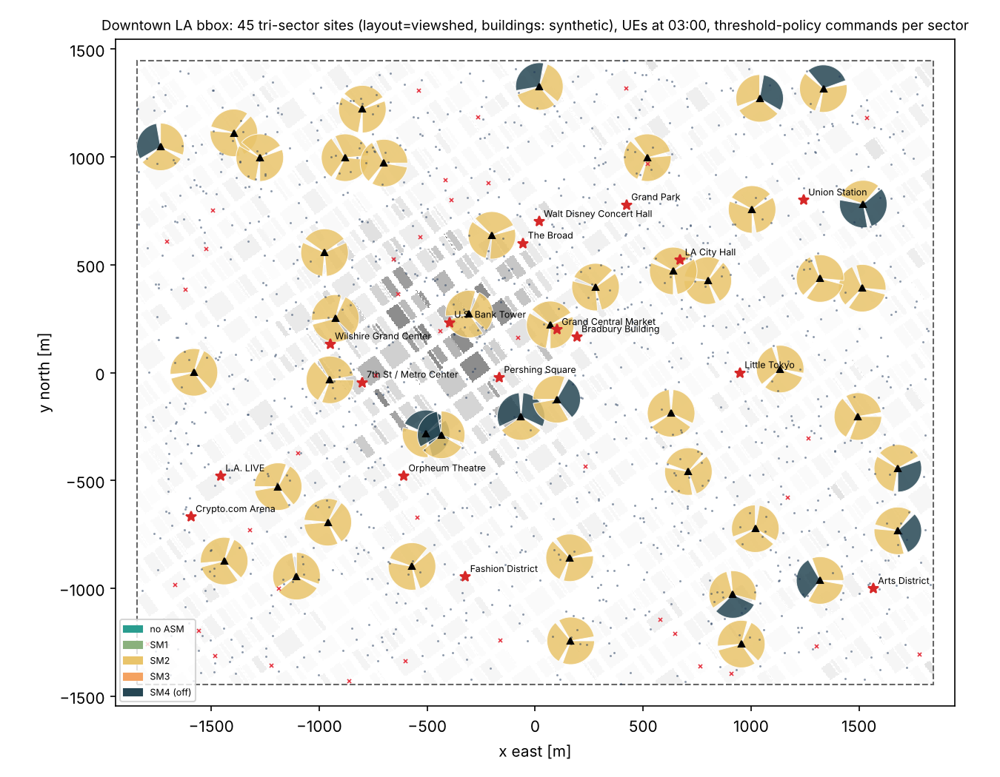

# oran_asm_sim: an O-RU sleep-mode simulator for Gymnasium and RLlib

`oran_asm_sim` is a vectorised (numpy) downlink system-level simulator for studying **O-RU sleep control with the 3GPP Advanced Sleep Modes (SM1 to SM4)**. Each site hosts one O-RU, and each O-RU controls the power states of its three sectors. A controller chooses a sleep command for every sector once per decision step. The simulator returns the energy used and the QoS cost (delay, outage, dropped traffic) of that choice.

You can use it at three levels:

1. **As a plain simulator.** Call `ORANSystemSimulator.step(commands)` and read the metrics. RL libraries are not needed.
2. **As a Gymnasium environment.** `ORanASMEnv` has one central agent with a `MultiDiscrete` action (one entry per sector).
3. **As an RLlib `MultiAgentEnv`.** `ORanASMMultiAgentEnv` has one agent per O-RU. Each agent sets the sleep commands of its three sectors with a `MultiDiscrete([5, 5, 5])` action.

The default scenario is Downtown Los Angeles. Sites are placed on rooftops by iterative maximum-visibility placement, and LOS comes from building geometry. Everything (area, buildings, layout, radio, traffic, mobility, power model) is configurable.

---

## Contents

- [Installation](#installation)
- [Quick start](#quick-start)
- [How a step works](#how-a-step-works)
- [Environments and agents](#environments-and-agents)
- [Running your own experiments](#running-your-own-experiments)
  - [Configuring a scenario](#configuring-a-scenario)
  - [Using your own study area and buildings](#using-your-own-study-area-and-buildings)
  - [Writing and evaluating a policy](#writing-and-evaluating-a-policy)
  - [Using the simulator without Gymnasium](#using-the-simulator-without-gymnasium)
  - [Defining your own observation and reward](#defining-your-own-observation-and-reward)
  - [Training with RLlib](#training-with-rllib)
  - [Metrics reference](#metrics-reference)
- [Model details](#model-details)
- [Presets and speed](#presets-and-speed)
- [Baseline results](#baseline-results)
- [Assumptions and limitations](#assumptions-and-limitations)
- [Repository layout](#repository-layout)

---

## Installation

The package needs Python 3.9 or newer. The core simulator depends only on numpy and scipy. Install the extras you need:

```bash
pip install -e .                 # simulator only (numpy, scipy)
pip install -e ".[gym]"          # + Gymnasium environments
pip install -e ".[rllib]"        # + Ray RLlib and torch for training
pip install -e ".[viz,dev]"      # + matplotlib for plots, pytest for tests
```

Check the install:

```bash
pytest -q tests
```

**Building data (optional but recommended).** If you do not provide building footprints, the simulator generates a clearly labelled *synthetic* DTLA-like city and prints a warning. To use real OpenStreetMap buildings, download them once:

```bash
python tools/fetch_osm_buildings.py --out data/dtla_buildings.geojson
```

and pass `{"geometry": {"buildings_geojson": "data/dtla_buildings.geojson"}}` in your config.

---

## Quick start

```python
from oran_asm_sim import ORanASMEnv

env = ORanASMEnv({"env": {"seed": 0, "start_hour": 12.0}})
obs, info = env.reset()
for _ in range(10):
    action = env.action_space.sample()   # one sleep command (0..4) per sector
    obs, reward, terminated, truncated, info = env.step(action)
print(info["power_total_w"], info["qos_violation_frac"])
```

The first construction of a scenario builds the building raster, site placement and viewsheds. This takes about 10 s, and the results are cached on disk, so later runs start in well under a second.

Ready-made scripts:

```bash
python examples/run_baselines.py --out results                         # 24 h study of the non-learning baselines
python examples/train_rllib.py --mode single --preset fast --iters 50  # PPO, one central agent
python examples/train_rllib.py --mode multi --preset dtla_19site       # PPO, one agent per O-RU
python examples/plot_geometry.py --out results                         # buildings, viewsheds, placement
```

---

## How a step works

**Decision step.** One call to `step()` holds the sleep commands for `env.decision_interval_s` (default 1 s). The default is at the slow end of the Near-RT RIC control loop (10 ms to 1 s) and equals the SM4 minimum sleep.

**Mini-periods.** Each step is split into `env.n_mini` scheduling mini-periods (default 10 × 100 ms). Each mini-period runs these stages in order:

1. Mobility: UEs move.
2. Large-scale channel and RSRP association, with 3 dB handover hysteresis.
3. FTP-3 traffic arrivals.
4. Load-coupled per-RBG interference.
5. 2x2 fast fading, and rank/CQI selection.
6. Proportional-fair scheduling, which drains the UE buffers.
7. Energy integration with the sleep-mode model.

A mini-period stands for `dt / slot × TDD-DL-fraction` slots that share one fading realisation.

**Actions.** Each sector takes one of five commands:

| Command | Meaning |
|---|---|
| 0 | **No ASM.** The sector stays active. Between bursts it idles at signalling load (SSB/PDCCH/CSI-RS, ≈ 7 % PRB-equivalent). |
| 1, 2, 3 | **Opportunistic SMk.** The cell stays on air and enters SMk in every idle gap that is at least the minimum sleep time for that mode (deactivation + activation). SSB transmissions every 20 ms split idle time into gaps, so SM1 and SM2 fit easily and SM3 (10 ms) fits only sometimes. Waking for a traffic burst adds the activation time (35.5 µs / 0.5 ms / 5 ms) to the service delay. |
| 4 | **SM4: switch the sector off.** 0.5 s deactivation, then 15 W deep sleep. When any other command is given it takes 0.5 s to reactivate. UEs are handed over immediately and no SSB is sent, so coverage depends on the neighbouring sectors. |

You can restrict the commands an agent may use with `env.action_set`, for example `(0, 2, 4)`. Action indices then map to those commands in order.

---

## Environments and agents

**O-RUs and sectors.** Each site hosts one O-RU, and each O-RU drives three sectors (azimuths 30°/150°/270°, rotated per site by viewshed placement). Every sector has its own RF chain and its own sleep state, so commands are given per sector. `sim.dep.sector_site[s]` gives the site (O-RU) of sector `s`.

**Single agent (`ORanASMEnv`).** One central controller. The action is `MultiDiscrete([L] * n_sectors)`, one command index per sector, where `L = len(env.action_set)`.

**Multi-agent (`ORanASMMultiAgentEnv`).** One agent per O-RU, with IDs `"oru_0"`, `"oru_1"`, ... (one per site). Agent `oru_i` controls the three sectors `ma.sectors_of[i]`, in that order, and its action is `MultiDiscrete([L, L, L])`. All agents act at every step. To convert per-O-RU actions to a per-sector array, call `ma.sector_actions(actions)` with either a dict keyed by agent ID or an array of shape `[n_oru, 3]`; agents missing from a dict send command index 0. The full metrics `info` dict is attached to the first agent's info.

| Attribute | Shape | Meaning |
|---|---|---|
| `ma.n_oru` | | number of O-RUs (sites) |
| `ma.sectors_of` | `[n_oru, 3]` | sector indices controlled by each O-RU |
| `ma.core` | | the underlying `ORanASMEnv`; the simulator is `ma.core.sim` |

---

## Running your own experiments

### Configuring a scenario

All configuration lives in nested dataclasses in [oran_asm_sim/config.py](oran_asm_sim/config.py):

| Section | Class | Controls |
|---|---|---|
| `geometry` | `GeometryConfig` | study area, buildings, site layout and placement |
| `radio` | `RadioConfig` | carrier, bandwidth, antennas, path loss, link adaptation, handover |
| `mobility` | `MobilityConfig` | community mobility model, daily schedule, speeds |
| `traffic` | `TrafficConfig` | FTP-3 file size and rate, diurnal profile, delay budget |
| `power` | `PowerConfig` | O-RU power model and sleep-mode parameters |
| `env` | `EnvConfig` | step length, episode length, UE count, start hour, reward weights, seed |

Every default value has its source cited inline in `config.py`. Each environment takes a partial nested dict, which is the same format as RLlib's `env_config`. Any key you leave out keeps its default:

```python
env = ORanASMEnv({
    "radio": {"scenario": "UMi"},                      # UMi defaults (h_BS, ISD, ...) are applied for you
    "traffic": {"peak_rate_files_per_s": 2.0, "delay_budget_s": 0.2},
    "env": {"n_ues": 600, "episode_steps": 900, "random_start": True, "seed": 1},
})
```

Dotted keys also work: `{"radio.scenario": "UMi", "env.seed": 1}`. A misspelled key raises `KeyError`, so typos fail loudly.

**Presets.** The presets in `PRESETS` are named starting points:

```python
from oran_asm_sim.config import preset
cfg = preset("dtla_19site", env={"seed": 3, "episode_steps": 600})   # returns a SimConfig
env = ORanASMEnv(cfg)
```

See [Presets and speed](#presets-and-speed) for what each preset contains.

**Seeds and reproducibility.** Set `env.seed`. Each `reset()` without an explicit seed moves on to a new but deterministic seed. Under RLlib, each env runner gets its own offset automatically. Pass `env.reset(seed=..., options={"start_hour": h})` to pin an episode to an exact seed and time of day.

### Using your own study area and buildings

The study area is a WGS-84 bounding box, `geometry.bbox = (south, west, north, east)`. To simulate another city:

```bash
python tools/fetch_osm_buildings.py --bbox 40.700 -74.020 40.720 -73.990 --out data/fidi.geojson
```

```python
env = ORanASMEnv({"geometry": {
    "bbox": (40.700, -74.020, 40.720, -73.990),
    "buildings_geojson": "data/fidi.geojson",
}})
```

The simulator accepts building footprints as GeoJSON or raw Overpass/OSM JSON. Heights come from `height`, `HEIGHT`, `building:height` or `building:levels × 3.5 m`. For other sources, set `building_height_field` and `building_height_scale`; for example, the LA County building outlines use `building_height_field="HEIGHT", building_height_scale=0.3048`.

**Site layout** (`geometry.layout`):

- `"viewshed"` (default): iterative maximum-visibility rooftop placement (Masrur et al., arXiv:2511.22105, Sec. III-A). The main knobs are `max_sites`, `min_gain_frac`, `coverage_target`, `cand_min_height_m` / `cand_max_height_m`, `candidate_spacing_m`, `max_candidates`, `viewshed_radius_m`, `mast_height_m`, `optimize_azimuth` and `tilt_ground_m`.
- `"fill"`: a hexagonal lattice tiling the bbox, with spacing `isd_m`.
- `"rings"`: the classic 19-site / 57-cell cluster (`n_rings=2`) centred on the bbox.

All three layouts use LOS computed from the buildings. Set `radio.los_model="stochastic"` to use the TR 38.901 LOS probability instead.

The paper's placement rule is "add sites until visibility stops improving". Over a 3.7 × 2.9 km downtown this would add hundreds of sites, because the gain per site decays slowly (2.4 % for the first site and still 0.5 % at site 60). The defaults therefore stop at 45 sites, roughly the density of a 500 m ISD grid. Set `min_gain_frac=0` and raise `max_sites` to apply the strict rule. Visibility-driven placement is a mmWave heuristic: at 3.5 GHz, NLOS links carry most of the traffic, so the LOS-coverage figure is a siting criterion, not a coverage KPI.

**Caches.** Rasters, placements and viewsheds are cached in `~/.cache/oran_asm_sim`. Set `$ORAN_ASM_CACHE` or `geometry.cache_dir` to use another location. Cache entries are keyed by a content hash of the geometry and placement parameters, so changing any of them triggers a recompute and stale results are never used.

### Writing and evaluating a policy

A policy is any callable `policy(env, obs) -> commands` that returns an integer array of length `env.S` with values in `0..4`. `run_policy` runs one episode and returns the per-step `info` dicts, with the reward included:

```python
import numpy as np
from oran_asm_sim import ORanASMEnv
from oran_asm_sim.baselines import AlwaysOn, FixedASM, LoadThresholdSM4, run_policy

class NightSM4:
    """SM2 by day; between 01:00 and 05:00, switch off sectors whose would-be UEs are few."""
    name = "night SM4"

    def __call__(self, env, obs=None):
        sim = env.sim
        hour = (sim.t / 3600) % 24
        cmd = np.full(env.S, 2)
        if 1 <= hour < 5:
            pot = np.bincount(sim.best_sector_if_all_on(), minlength=env.S)
            cmd[pot <= 3] = 4
        return cmd

env = ORanASMEnv({"env": {"seed": 0}})
for pol in [AlwaysOn(), FixedASM(2), LoadThresholdSM4(), NightSM4()]:
    rows = run_policy(env, pol, n_steps=60, seed=42, start_hour=3.0)
    print(f"{pol.name:24s} power={np.mean([r['power_total_w'] for r in rows]):8.0f} W  "
          f"qos_viol={np.mean([r['qos_violation_frac'] for r in rows]):.4f}")
```

A policy can read anything on `env.sim`. These are the most useful attributes:

| Attribute | Shape | Meaning |
|---|---|---|
| `sim.S`, `sim.U` | | number of sectors and UEs |
| `sim.t` | | simulated time in seconds since midnight |
| `sim.state` | `[S]` | cell state: 0 on, 1 deactivating, 2 SM4, 3 activating |
| `sim.serving` | `[U]` | serving sector of each UE, or −1 if in outage |
| `sim.backlog` | `[U]` | buffered bits per UE |
| `sim.last` | dict | metrics of the last step (see [Metrics reference](#metrics-reference)) |
| `sim.sector_offered_bps()` | `[S]` | expected offered load of the attached UEs |
| `sim.sector_backlog()` | `[S]` | total backlog of the attached UEs |
| `sim.sector_mean_sinr_db()` | `[S]` | mean wideband SINR of the attached UEs |
| `sim.best_sector_if_all_on()` | `[U]` | sector each UE would pick if every cell were on, which shows the demand hidden under sleeping cells |
| `sim.sinr_toward(ue_idx, sec_idx)` | `[P]` | SINR a UE would get from a given sector under the current interference |
| `sim.dep` | | deployment: site and sector positions, azimuths, buildings, placement |

[examples/run_baselines.py](examples/run_baselines.py) shows the full evaluation protocol we use: every hour of the day, simulated after a warm-up, aggregated into daily energy and QoS.

### Using the simulator without Gymnasium

`ORANSystemSimulator` has no RL dependencies. Use it directly when you want full control of the loop, or want to plug in a non-RL controller:

```python
import numpy as np
from oran_asm_sim import ORANSystemSimulator, SimConfig

cfg = SimConfig.from_dict({"geometry": {"layout": "rings", "n_rings": 1}})
sim = ORANSystemSimulator(cfg, seed=0)
sim.reset(seed=0, start_hour=9.0)
for _ in range(30):
    m = sim.step(np.full(sim.S, 2))          # commands, not action indices
print(m["power_total_w"], m["served_bps"] / 1e6, m["occupancy_sector"].mean(0))
```

`sim.step` returns the full metrics dict. Unlike the environment's `info`, it includes the per-sector and per-UE arrays.

`reset()` runs an always-on warm-up of `env.warmup_s` seconds (default 30 s) before returning, which fills buffers and the PF averages. This applies both to the simulator and to the environments. Set `warmup_s=0` to start from empty buffers.

### Defining your own observation and reward

The environments are thin wrappers around the simulator, so changing what an agent sees or optimises only needs a small subclass.

**Reward.** Override `reward(m)`, where `m` is the step's full metrics dict:

```python
class EnergyEfficiencyEnv(ORanASMEnv):
    def reward(self, m):
        ee = m["served_bps"] / max(m["power_total_w"], 1.0)        # bits per joule
        return float(np.log10(1 + ee) - 10.0 * m["outage_frac"])
```

**Observation (single agent).** Set `observation_space` in `__init__` and override `_obs()`:

```python
from gymnasium import spaces

class LoadOnlyEnv(ORanASMEnv):
    """Per sector: utilisation, offered load, cell state. Plus the hour of day."""
    def __init__(self, env_config=None, **kw):
        super().__init__(env_config, **kw)
        self.observation_space = spaces.Box(-1.0, 2.0, (self.S * 3 + 2,), np.float32)

    def _obs(self):
        sim, S = self.sim, self.S
        util = sim.last.get("util_sector", np.zeros(S))
        load = np.clip(sim.sector_offered_bps() / 500e6, 0, 2)
        state = sim.state / 3.0
        h = 2 * np.pi * (sim.t / 3600 % 24) / 24
        return np.concatenate([util, load, state, [np.sin(h), np.cos(h)]]).astype(np.float32)
```

**Observation (multi-agent).** Subclass `ORanASMMultiAgentEnv` and do the same thing. Set `self.observation_spaces` (a dict keyed by agent ID, `"oru_0"`, `"oru_1"`, ...) and `self.observation_space` in `__init__`, and override `_obs()` to return a dict keyed by agent ID. Use `self.sectors_of[i]` to select the sectors of O-RU `i`. The underlying single-agent env is available as `self.core`, and the simulator as `self.core.sim`. Override `step()` if you want per-agent rewards.

A subclass works anywhere the base class does, including in RLlib: `PPOConfig().environment(LoadOnlyEnv, env_config=...)`.

### Training with RLlib

```python
from ray.rllib.algorithms.ppo import PPOConfig
from oran_asm_sim import ORanASMEnv, ORanASMMultiAgentEnv
from oran_asm_sim.config import PRESETS

env_config = {**PRESETS["fast"], "env": {**PRESETS["fast"]["env"], "random_start": True, "seed": 0}}

# One central agent
cfg = PPOConfig().environment(ORanASMEnv, env_config=env_config)

# One agent per O-RU, sharing one policy
cfg = (PPOConfig()
       .environment(ORanASMMultiAgentEnv, env_config=env_config)
       .multi_agent(policies={"oru_policy"},
                    policy_mapping_fn=lambda agent_id, episode, **kw: "oru_policy"))
algo = cfg.build_algo()
```

`oran_asm_sim.register()` registers the environments as `"ORanASM-v0"` for `gym.make`, and as `"oran_asm"` / `"oran_asm_ma"` for RLlib's string registry.

**Simulation cost and resolution:**

- The cost of a step scales with the number of backlogged UEs. Busy hours are about twice as slow as night hours.
- Keep `decision_interval_s / n_mini` at or below about 0.1 to 0.2 s. The queueing-delay QoS measure is not meaningful with multi-second mini-periods.

### Metrics reference

The `info` dict returned by `step()` contains these scalars:

| Key | Meaning |
|---|---|
| `time_s`, `hour`, `period` | simulated time, hour of day, mobility period name (`home`, `work`, `lunch`, `evening`) |
| `power_total_w`, `power_norm`, `energy_j` | network power, power divided by the all-on full-load power, energy over the step |
| `offered_bps`, `served_bps`, `backlog_bits` | traffic offered and served, total buffered bits |
| `qos_violation_frac` | fraction of UEs whose estimated queueing delay plus wake-up latency exceeds `traffic.delay_budget_s` |
| `outage_frac` | fraction of UEs with no usable cell (RSRP below `radio.rsrp_min_dbm`) |
| `drop_frac`, `blocked_frac` | traffic dropped on buffer overflow, and traffic offered by UEs in outage |
| `ue_tput_mean_bps`, `ue_tput_p5_bps` | mean and 5th-percentile throughput of UEs with data |
| `wake_latency_s` | mean wake-up delay added per traffic burst |
| `handovers`, `ho_mobility`, `ho_forced`, `ho_intra_site`, `ho_inter_site`, `ho_pingpong`, `ho_pingpong_frac`, `rlf`, `reconnects`, `ho_rate_per_ue_s` | handover statistics. A forced handover is caused by a sector going to sleep. |

`env.sim.last`, or the return value of `sim.step`, also holds these arrays:

| Key | Shape | Meaning |
|---|---|---|
| `power_sector_w` | `[S]` | power per sector |
| `util_sector` | `[S]` | busy-time fraction |
| `sleep_frac_sector` | `[S]` | fraction of time asleep |
| `occupancy_sector` | `[S, 7]` | time fraction in: no ASM, SM1, SM2, SM3, deactivating, SM4, activating |
| `served_sector_bps` | `[S]` | throughput served per sector |
| `n_ue_sector` | `[S]` | attached UEs per sector |
| `state_sector` | `[S]` | cell state at the end of the step |
| `ue_offered_bps`, `ue_served_bps` | `[U]` | offered and served rate per UE |
| `ho_out_sector`, `ho_in_sector` | `[S]` | handovers out of and into each sector |

---

## Model details

| Component | Module | Model |
|---|---|---|
| Geometry | `geometry.py`, `tools/fetch_osm_buildings.py` | A WGS-84 bbox, or a GeoJSON polygon, is projected to a local ENU frame. Building footprints are rasterised to a cached 5 m height grid, and the outdoor cells form the service area. A UE inside a footprint is indoor: it takes the LOS state of its nearest outdoor (facade) cell, and its O2I `d_2D-in` is the real distance to that facade. Named landmarks act as mobility communities. |
| LOS | `placement.py`, `channel.py` | Each site gets a cached voxel viewshed (radial sweep, antenna at roof + mast, UE at 1.5 m), and UE-to-site LOS is an O(1) lookup into it. It agrees with brute-force ray tracing on more than 95 % of samples (98 % on the default DTLA raster). |
| Path loss | `channel.py` | TR 38.901 UMa/UMi LOS/NLOS path loss using the geometric LOS state and per-site antenna heights, log-normal shadowing with AR(1) spatial correlation (Table 7.6.3.1-2), O2I low/high-loss and in-car penetration (7.4.3). |
| O-RUs and sectors | `geometry.py`, `power.py` | One O-RU per site, controlling 3 sectors at 30°/150°/270°, rotated per site by viewshed placement. Each sector has its own 4T4R RF chain (PA, analog front end, digital unit) and its own sleep state. |
| Scheduling | `scheduler.py` | Proportional fair per RBG (16 PRB, 273 PRB at 100 MHz / 30 kHz), with virtual-slot time-sharing and buffer draining. |
| Traffic | `traffic.py` | 3GPP FTP model 3 (0.5 MB Poisson files), 24 h diurnal profile, per-UE lognormal activity. |
| MIMO | `channel.py` | 2x2 Rayleigh/Rician (K = 9 dB in LOS) per RBG, SVD precoding, wideband rank adaptation (1 or 2 layers), TS 38.214 CQI mapping. |
| Placement | `placement.py` | Candidates are rooftop cells on building edges that face the service area, keeping the tallest roof per 40 m cell (up to 1200). A greedy loop adds the site that increases LOS-visible service area the most. Each site's azimuth is rotated to cover what it sees, and its downtilt aims 250 m out. The result is cached: about 10 s the first time, about 0.05 s afterwards. |
| Power and ASMs | `power.py` | Usman et al. (CCNC 2025), Eq. (2)/(4)/(5)/(6): scaling exponents from Tables II/III, deactivation sets from Table VI, ASM timing from Table I. Reproduces Table VII exactly. |
| Mobility | `mobility.py` | Hsu et al. (INFOCOM 2007) time-variant community model: normal and concentration movement periods, local/roaming Markov chain, random-direction epochs, POI communities (Sec. V extension). |

### Power model (per sector, 4T4R, Table V operating point)

| State | RF unit | Digital | Total | Paper Table VII |
|---|---|---|---|---|
| Full load | 365 W | 32 W | 397 W | 365 / 32 / 397 |
| SM1 | 61 | 27 | 88 | 60–61 / 25–27 / 88 |
| SM2 | 25 | 15 | 40 | 23–25 / 13–15 / 40 |
| SM3 | 18 | 10 | 28 | 16–18 / 8–10 / 28 |
| SM4 | 10 | 5 | 15 | 8–10 / 3–5 / 15 |

Active power follows Eq. (2), with streams and modulation taken from what the scheduler actually used. The PA follows Eq. (6) with `η(P_T) = η_max (P_T/P_max)^0.5` plus a 10 W bias per chain, and `η_max` is calibrated to a 291 W PA at full load (4 × 40 W). Active-idle power is about 172 W.

Energy per mini-period is `busy·P_active(load=1) + Σ gaps [transitions·P_trans + sleep·P_SMk] + wake·P_trans`. The busy time comes from the scheduler, and `P_trans` is the mean of the active-idle and SMk powers.

**Calibration caveat.** The paper does not publish the individual P_i,ref values. The values in `power.py::_COMPONENTS` are calibrated to reproduce Table VII. Components that Table VI never switches off (feedback VCO, control, network) carry the residual sleep power, and in SM4 they are scaled by a retention factor so that the total matches the SM4 row. You can check the calibration with `ORUPowerModel(...).table_vii()`.

---

## Presets and speed

Timings are from a 2-core cloud VM with numpy 2, running a single process.

| Preset | Layout | Sites / sectors / UEs | ms per 1 s step (night / busy hour) |
|---|---|---|---|
| `dtla_full` (default) | viewshed placement | 45 / 135 / 1350 | ~70 / ~150 |
| `dtla_hex` | hex fill, geometric LOS | 45 / 135 / 1350 | ~75 / ~130 |
| `dtla_19site` | 19-site rings | 19 / 57 / 570 | ~30 / ~65 |
| `fast` | 7-site rings, 5 mini-periods, 300-step episodes | 7 / 21 / 210 | ~8 / ~20 |

MIMO fading and CQI are only computed for UEs with data, so cost scales with the number of backlogged UEs. RLlib parallelises across env runners.

---

## Baseline results

These are the results of `python examples/run_baselines.py` (seed 7) on the default viewshed placement over the **synthetic** city: 45 sites, 135 sectors, 1350 UEs. Each hour of the day is simulated for 60 s at 1 s / 100 ms resolution, after a 20 s always-on warm-up. Daily energy is the sum of the hourly mean power. The busy hour runs at about 35 % PRB utilisation.

| Policy | kWh/day | Saving | UEs over delay budget (mean / busy hour) | Outage | Wake latency |
|---|---|---|---|---|---|
| Always on (no ASM) | 708 | – | 0.46 % / 1.25 % | 2.66 % | – |
| Opportunistic SM1 | 499 | 29.5 % | 0.47 % / 1.30 % | 2.66 % | 0.02 ms |
| Opportunistic SM2 | 387 | 45.4 % | 0.45 % / 1.35 % | 2.67 % | 0.31 ms |
| Opportunistic SM3 | 446 | 37.0 % | 0.47 % / 1.30 % | 2.67 % | 2.66 ms |
| Threshold SM4 + SM2 | 377 | 46.9 % | 0.50 % / 1.37 % | 2.75 % | 0.30 ms |

SM3 saves *less* than SM2. With a 20 ms SSB period, each idle gap pays 10 ms of SM3 transitions at transition power, while SM2 pays only 1 ms, so under this calibration SM2 at 40 W beats SM3 at 28 W.





---

## Assumptions and limitations

Read these before publishing results from the simulator.

- **Downlink only.** TDD is modelled as a DL fraction. There is no UL traffic and no UL power.
- **Outage.** About 2.5–5 % of UEs are in outage (RSRP < −130 dBm/RE). These are deep-indoor UEs (half of buildings are high-loss IRR glass) that a 3.5 GHz macro-only grid cannot reach. With imported geometry, a UE is indoor exactly when it is inside a footprint; without geometry, 80 % of paused UEs are indoor. Their traffic counts as `blocked_frac`. Tune `radio.paused_indoor_prob`, `radio.high_loss_building_prob` or `radio.rsrp_min_dbm` to change this.
- **Link abstraction.** Ideal CSI, single-user MIMO and no HARQ timeline. Goodput = CQI efficiency × (1 − BLER target). Interferers are treated as spatially white, with per-RBG on/off activity driven by each sector's last utilisation.
- **CQI thresholds** are the commonly used AWGN 10 %-BLER switching points, not a 3GPP-normative table.
- **No wrap-around.** The area is real and finite, so edge sites see less interference.
- **Flat terrain.** Building heights are above ground and there is no elevation model (DTLA has about 30 m of relief on Bunker Hill). Viewsheds are 2.5-D on a 5 m raster and do not model reflections or diffraction. Beyond `viewshed_radius_m` (800 m for placed sites, 1500 m for hex sites), links are treated as NLOS.
- **Idle gaps** inside a mini-period are analytic: gaps are delimited by SSB occasions and traffic bursts, and each gap is assumed to have the mean length.
- **Mobility deviations.** UEs move through building footprints, and those inside one are indoor; the original paper keeps UEs outdoors. A UE that starts a local epoch outside its community walks or drives there instead of teleporting, which keeps handovers physical. POI coordinates are approximate.
- **Eq. (5)** analog node scaling is implemented as printed in the paper. It is the identity at the 5 nm reference, so the default results do not depend on it.

---

## Repository layout

```
oran_asm_sim/
  config.py        configuration dataclasses, PRESETS, preset()
  simulator.py     ORANSystemSimulator: the simulation engine (no RL dependencies)
  env.py           ORanASMEnv (single agent) and ORanASMMultiAgentEnv (one agent per O-RU, 3 sectors each)
  baselines.py     AlwaysOn, FixedASM, LoadThresholdSM4, run_policy
  geometry.py      study area, building import and rasterisation, deployment
  placement.py     viewsheds and iterative max-visibility site placement
  channel.py       path loss, shadowing, penetration, MIMO link abstraction
  scheduler.py     proportional-fair scheduler
  traffic.py       FTP-3 traffic with diurnal profile
  mobility.py      time-variant community mobility
  power.py         O-RU power model and ASM timing
  viz.py           plot_network() for maps
examples/          baseline study, PPO training, geometry plots
tools/             OSM building downloader
tests/             pytest suite
results/           baseline outputs and figures
```
